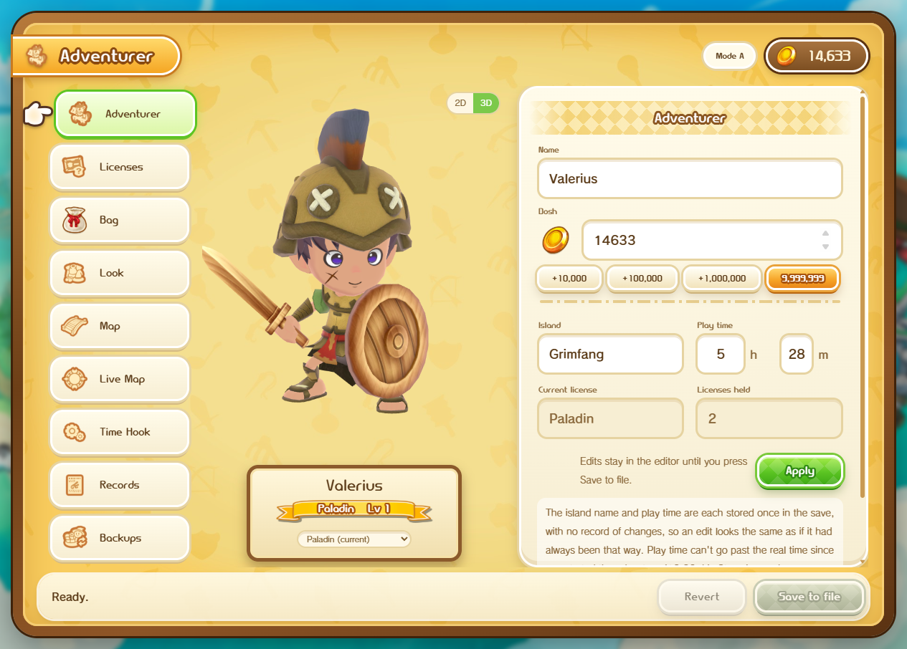
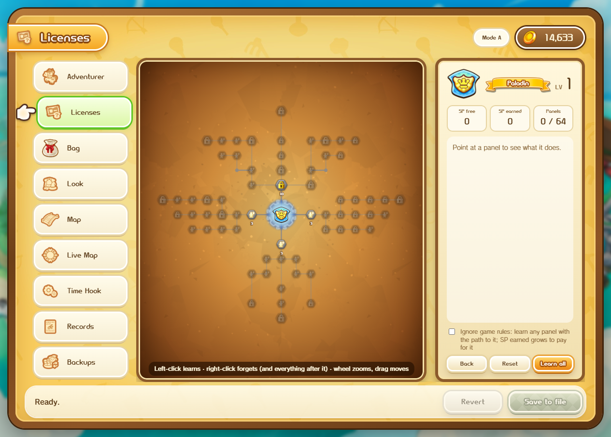
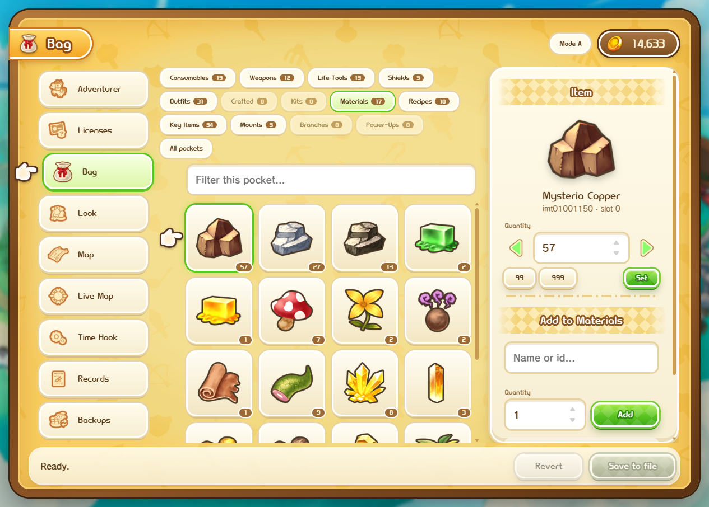
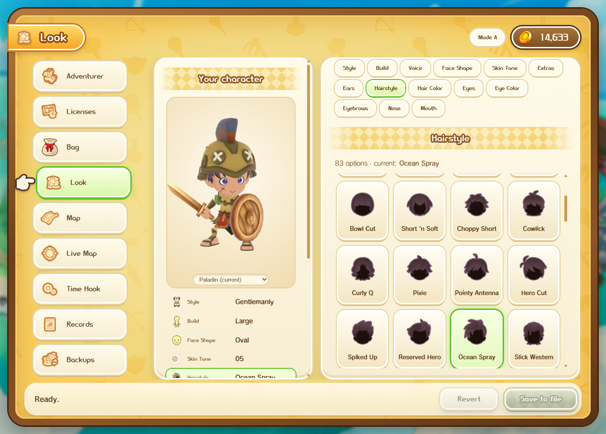
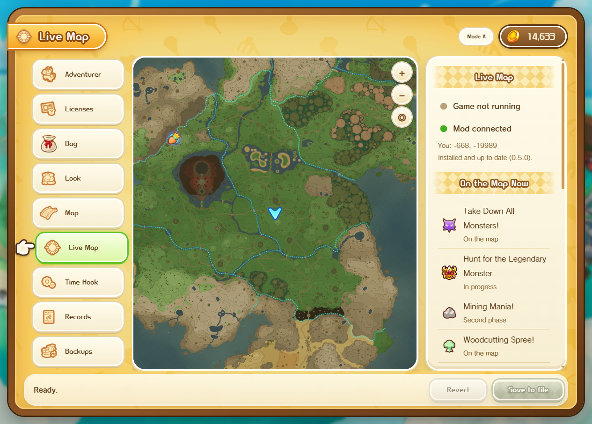
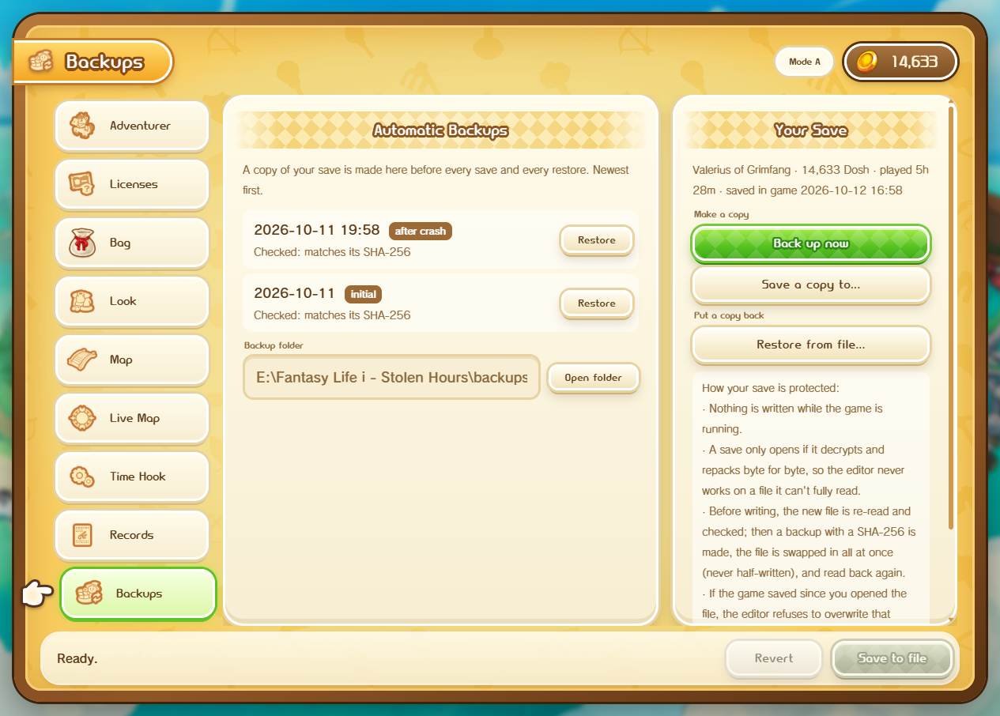

# Stolen Hours

A free save editor for **Fantasy Life i: The Girl Who Steals Time** (PC, Steam).

## Download

Get the latest zip from [Releases](../../releases), unzip it anywhere and run `StolenHours.exe`.
Nothing to install: it finds Steam, the game and your save by itself.

Needs Windows 10 or 11 (with the Microsoft Edge WebView2 runtime, which Windows already has) and the game installed
through Steam.

## What it does

| Tab | What you can change |
|---|---|
| Adventurer | Name, Dosh, island name, play time |
| Licenses | Level, exp and rank of every Life |
| Skill boards | Learn or reset skill panels |
| Bag | Item amounts, add new items to any pocket |
| Look | Your appearance, with a 3D preview |
| Map | Which map events show up, time and weather |
| Live Map | Map events and where you are while the game runs |
| Time Hook | Change the running game (Dosh) |
| Records | Your play records |
| Backups | Automatic backups, one-click restore |

Live Map and Time Hook need [UE4SS](https://github.com/UE4SS-RE/RE-UE4SS) in the game. The editor installs its own
small mod for you (from either tab) once UE4SS is there. Everything else works on the save file alone.

| | |
|---|---|
|  |  |
|  |  |

## Keeping your save safe

- It won't write while the game is running. Close the game before you press **Save to file**.
- A save only opens if it decrypts and repacks byte for byte, so the editor never works on a file it can't fully read.
- Before every write it makes a backup with a SHA-256, writes the new file in one go and reads it back to check it.
- If the game saved since you opened the file, it refuses to overwrite it.

Still, keep your own copy of your save. Use it offline and at your own risk; don't take edited saves into multiplayer.

## Credits

- Item, flag and skill lists from Niedzielan's fli_save_editor.
- Fantasy Life i is © LEVEL-5. This is a fan-made tool, not affiliated with or endorsed by LEVEL-5.
