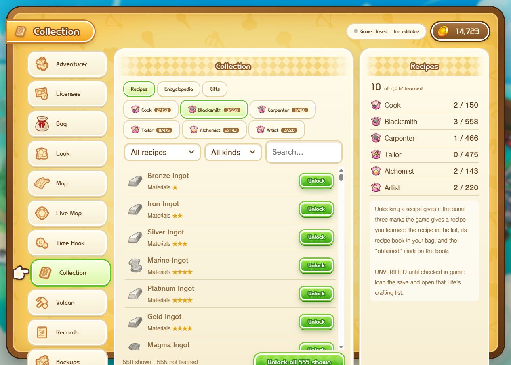
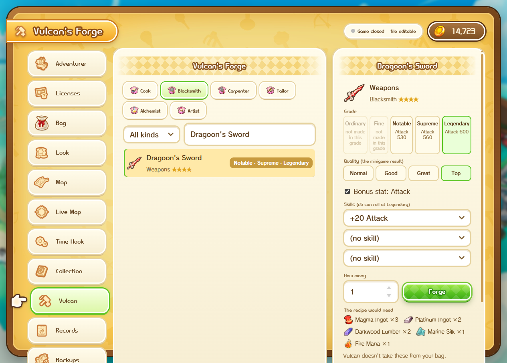

# Stolen Hours

A free save editor for **Fantasy Life i: The Girl Who Steals Time** (PC, Steam).

Watch the 1-minute tour on [YouTube](https://youtu.be/HJLNRAUg9rw).

## Download

Get the latest zip from [Releases](../../releases), unzip it anywhere and run `StolenHours.exe`.
Nothing to install: it finds Steam, the game and your save by itself.

Needs Windows 10 or 11 (with the Microsoft Edge WebView2 runtime, which Windows already has) and the game installed
through Steam.

## What it does

| Tab | What you can change |
|---|---|
| Adventurer | Name, Dosh, island name, play time |
| Licenses | Level, exp and rank of every Life |
| Skill boards | Learn or reset skill panels |
| Bag | Item amounts, add new items to any pocket |
| Look | Your appearance, with a 3D preview |
| Map | Which map events show up, time and weather |
| Live Map | Every map with towers, towns, shrines, shops, campfires, gathering spots and monsters; live map events and where you are while the game runs |
| Time Hook | Change the running game (Dosh) |
| Collection | Learn recipes, fill in the Encyclopedia, claim gifts again, gift codes with their rewards |
| Vulcan's Forge | Craft any recipe's item out of game and pick how it comes out: grade (Ordinary to Legendary, as far as that item goes), quality (Normal to Top), bonus stat and skills, or the + version of food and potions |
| Records | Your play records |
| Backups | Automatic backups, one-click restore |

The Live Map's places work on their own; its live events, your position and the Time Hook need [UE4SS](https://github.com/UE4SS-RE/RE-UE4SS) in the game. The editor installs its own
small mod for you (from either tab) once UE4SS is there. Everything else works on the save file alone.

## Every tab

| | |
|---|---|
| **Adventurer**  | **Licenses**  |
| **Skill board**  | **Bag**  |
| **Look**  | **Map**  |
| **Live Map**  | **Time Hook**  |
| **Collection**  | **Vulcan's Forge**  |
| **Records**  | **Backups**  |

## Keeping your save safe

- It won't write while the game is running. Close the game before you press **Save to file**.
- A save only opens if it decrypts and repacks byte for byte, so the editor never works on a file it can't fully read.
- Before every write it makes a backup with a SHA-256, writes the new file in one go and reads it back to check it.
- If the game saved since you opened the file, it refuses to overwrite it.

Still, keep your own copy of your save. Use it offline and at your own risk; don't take edited saves into multiplayer.

## Source

This repo includes the editor and Time Hook mod source.

| Path | What |
|---|---|
| `editor/` | Python package (save codec, CLI, web GUI, tests) |
| `hook/` | UE4SS Lua mod + `install_live.ps1` |
| `docs/` | Blueprint, verified findings, rebuild notes |
| `tools/` | Asset extractor source + third-party fetch notes |

**Run from source (Windows):**

1. Python 3.12: `py -3.12 -m pip install -r editor\requirements.txt pywebview`
2. Optional UI art from the game paks: install the game, fetch tools listed in `tools\README.md`, then  
   `cd editor` → `py -3.12 -m stolenhours build-ui` (writes `editor\stolenhours\webgui\web\game\`, gitignored).
3. Save key: the shipped exe pulls it from the game binary. For the Python tree, either run once with the game
   installed (`container.resolve_key`) or put `research\private\aes_key.hex` (gitignored; never commit keys).
4. `StolenHours.cmd` or `cd editor` → `py -3.12 -m stolenhours`
5. Tests: `cd editor` → `py -3.12 -m pytest -q tests`

Game art/fonts under `web\game\` and keys under `research\private\` are **not** in this repo on purpose.

## Community

Questions, bug reports and feedback: [Reveria Guild Hall on Discord](https://discord.gg/YvAJJ9kpzu).

## Credits

- Built by Unholy with his friend Tock, his AI coding partner.
- Item, flag and skill lists from Niedzielan's fli_save_editor.
- Fantasy Life i is © LEVEL-5. This is a fan-made tool, not affiliated with or endorsed by LEVEL-5.
